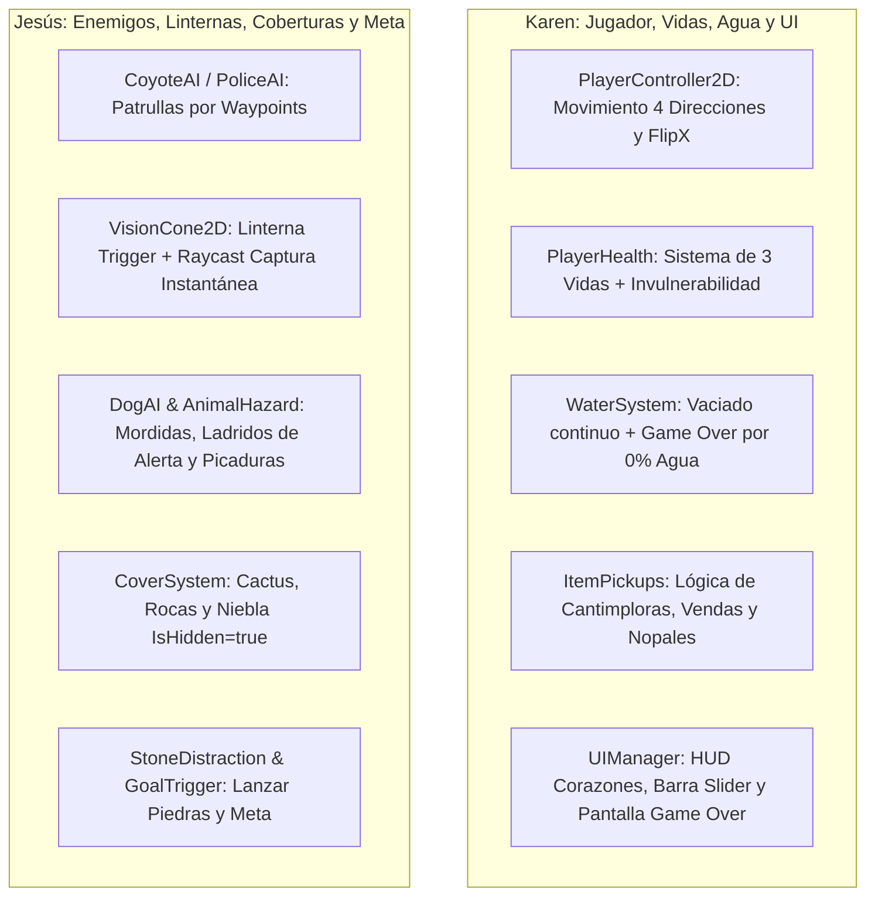

# Resumen General del Proyecto: "Sombras de la Frontera" (Nivel 1)

Este documento compila el estado completo del proyecto: ideas iniciales del documento académico, mejoras consensuadas, inventario exhaustivo de sprites generados, lo que queda pendiente, y la división equitativa de trabajo para el desarrollo en Unity.

---

## 1. Ficha del Proyecto y Concepto Base
* **Título Tentativo:** Sombras de la Frontera.
* **Plataforma:** PC (Unity 2D).
* **Integrantes del Equipo:** Karen Anahí Padrón Martínez y José de Jesús Loredo Melendez.
* **Docente:** Gabriel Barrón Rodríguez (UTNG).
* **Alcance Actual Inmediato:** **Nivel 1: El Desierto** (de un total proyectado de 4 niveles).
* **Objetivo de Juego en Nivel 1:** Controlar a Mateo a lo largo de un extenso trayecto en el desierto para alcanzar la zona de meta (orilla del río) sin ser capturado por coyotes con linterna, picado letalmente por animales venenosos o sucumbir a la deshidratación.

---

## 2. Ideas Originales (Documento PDF) vs. Nuevas Mejoras Implementadas

| Característica | Idea Original (PDF) | Mejora / Ajuste Implementado |
| :--- | :--- | :--- |
| **Perspectiva** | Vista lateral plana 2D "cutaway" (casa de muñecas). | **Vista Cenital Angulada (3/4 Vertical):** Mapa largo de avance hacia el norte (rumbo al río). |
| **Sistema de Daño** | Reinicio inmediato ante cualquier contacto enemigo. | **Sistema de 3 Vidas (Corazones):** Contacto con fauna resta 1 vida con breve invulnerabilidad. |
| **Detección por Coyote** | Reinicio de tramo. | **Captura Instantánea:** La linterna de un coyote causa Game Over automático (ignora las 3 vidas). |
| **Deshidratación (Agua)** | Barra genérica de agua/energía. | **Derrota por Sed:** Barra con vaciado continuo por tiempo. Al llegar a 0% causa Game Over instantáneo. |
| **Consumibles (Pickups)** | Mención general de recoger recursos. | **Ítems Específicos:** Cantimplora (+25% agua), Tuna/Nopal (+7% agua y boost de velocidad 3s), Botiquín (+1 vida). |
| **Mecánica de Distracción** | Mención general de ruidos. | **Piedras Arrojables:** Ítem recogible que se lanza para desviar la mirada y linterna del enemigo. |
| **Terreno Hostil** | Rocas y desierto simple. | **Arena Trampa / Movediza:** Reduce la velocidad de movimiento del jugador un **50%**. |
| **Comportamiento Canino** | Perros que alertan a patrullas. | **Doble Función:** Visión/alerta a distancia (ladrar) + Ataque de proximidad (mordida en su lugar que resta 1 vida). |
| **Coberturas** | Matorrales y rocas. | **Diversidad de Coberturas:** Cactus altos, rocas bajas, matorrales y restos de camionetas abandonadas. |
| **Estructura del Mapa** | Un solo tramo corto. | **Escenario Modular de 4 Tramos Conectados:** Garantiza un nivel extenso de varios minutos de juego. |

---

## 3. Inventario Completo de Assets (Sprites, Escenarios y Sprints)

### ✅ Lo que YA ESTÁ LISTO (En las carpetas del proyecto):

#### 🧑‍🌾 Personajes Jugables - `Sprites\players\`
1. **Mateo (Protagonista Base):**
   * `mateo_part1.jpeg`: Caminar lateral (6 frames) + Reposo/Idle en 3/4 (6 frames).
   * `mateo_part2.jpeg`: Caminar de espaldas hacia el norte (6 frames) + Lanzar piedra de espaldas (6 frames).
   * `mateo_part3.jpeg` / `mateo_defeat.jpeg`: Secuencia de daño/mareo y colapso de derrota con polvo (11 frames).
   * `mateo_hiding_hurt.png`: **Fondo transparente.** Esconderse limpio sin pared (6 frames) + Reacción de dolor (6 frames).
   * `mateo_defeat.png`: **Fondo transparente.** Colapso de derrota con espacio amplio (5 frames).
   * Respaldos en `Sprites\borradores\`.
2. **Sebastián (Personaje con Capucha):**
   * `sebastian_part1.jpeg`: Caminar lateral (6 frames) + Idle en 3/4 (6 frames).
   * `sebastian_part2.jpeg`: **¡Listo!** Caminar de espaldas hacia el norte (6 frames) + Recoger y lanzar piedra (6 frames).
   * `sebastian_part3.jpeg`: **¡Listo!** Secuencia de mareo/daño y colapso de derrota con polvo (11 frames).
   * `sebastian_base.png`: Modelo conceptual de 3 vistas en `Sprites\borradores\`.
3. **Carlos (Personaje con Bandana Roja):**
   * `carlos_part1.jpeg`, `carlos_part2.jpeg`, `carlos_part3.jpeg` y `carlos_defeat.jpeg`: Pack completo de animaciones (lateral, espaldas, lanzamiento de piedras y derrota).
   * `carlos_base.png` en `Sprites\borradores\`.

#### 🐕 Enemigos Caninos - `Sprites\enemies_coyote\` y `Sprites\enemies_police\`
1. **Bulldog (Coyote):** `bulldog_part1.jpg` (caminar/idle) y `bulldog_part2.jpg` (ladrar/morder/dormir).
2. **Rottweiler (Coyote):** `rottweiler_part1.jpeg` y `rottweiler_part2.jpeg`.
3. **Pastor Alemán K-9 (Policía):** `aleman_part1.jpeg` y `aleman_part2.jpeg` (con chaleco azul y placa).
4. **Dóberman K-9 (Policía):** `doberman_part1.jpeg` y `doberman_part2.jpeg` (con chaleco azul y placa).

#### 👤 Enemigos Humanos - `Sprites\enemies_coyote\` y `Sprites\enemies_police\`
1. **Persona Coyote:** `coyote_part1.jpeg` y `coyote_part2.jpeg` (con linterna).
2. **Policía Fronterizo:** `police_part1.jpeg` y `police_part2.jpeg` (con linterna y gorra).

#### 🦂 Fauna Nociva - `Sprites\enemies_atmosphere\`
1. **Alacrán / Escorpión:** `scorpion.jpg`.
2. **Araña:** `spider.jpeg`.
3. **Serpiente de Cascabel:** `snake_sprite_sheet.jpg` y `snake_sprite_sheet_transparente.png` (**¡Fondo transparente listo!**).

#### 🎒 Ítems, Coberturas e Interfaz (UI)
1. **Elementos de Interfaz (HUD):** `Sprites\IU\IU.jpeg` (3 corazones, marco y relleno de barra de agua, íconos de alerta `?` y `!`).
2. **Ítems del Suelo:** `Sprites\items\items.jpg` (cantimploras, frutos de nopal, botiquines y piedras).
3. **Obstáculos y Coberturas:** `Sprites\scenery_level1\obstacles_part1.jpeg` y `obstacles_part2.jpeg` (cactus, rocas, carrocerías).

#### 🏜️ Escenario Modular y Mapa Continuo - `Sprites\scenery_level1\`
1. `desert_1.jpeg`: Tramo 1 (Spawn al sur / Dunas vírgenes).
2. `desert_2.jpg`: Tramo 2 (Camino vehicular y huellas de neumáticos).
3. `desert_3.jpg`: Tramo 3 (Zona pedregosa y transición a humedad).
4. `desert_4.jpeg`: Tramo 4 (Ribera, lodo, pasto verde y río / Meta final).
5. **`mapa_completo_nivel1_seamless.png`:** **¡Listo!** Mapa continuo gigante unificado (572 x 3556 px) generado con solapamiento suave de 180 px entre tramos, sin cortes bruscos.
6. Prompts de actualización Image-to-Image documentados para encadenar las texturas si se regeneran en IA.

#### 🛠️ Herramientas Técnicas y Scripts
* `stitch_desert_map.py`: Script de Python con PIL para fusionar automáticamente los tramos del escenario con gradiente alfa suave.
* `process_sprites.py`: Script para convertir JPGs con fondo blanco a PNG con transparencia alfa.

#### 📋 Metodología y Documentación Ágil - `Sprints\`
* `Sprint_Escenario_Modular_Nivel1.md`: Documento oficial del Sprint para el profesor Gabriel Barrón con Historias de Usuario (Gherkin), Criterios de Aceptación, DoD y desglose de tareas (Jesús / Karen).

---

### ⏳ Lo que FALTA / Próximos Pasos Pendientes:
1. **Opcional - Mateo Frontal:** Caminata hacia el frente (Sur) y Reposo frontal directo en caso de requerir las 4 direcciones completas sin reutilizar el sprite lateral volteado.
2. **Procesamiento de Transparencias:** Ejecutar la limpieza de fondo blanco a PNG transparente con canal alfa en los sprites que aún estén en JPG (`sebastian_part2`, `sebastian_part3`, etc.) antes de cortarlos en Unity.
3. **Comenzar Desarrollo en Unity (C#):**
   * Configuración de la cámara y límites del mapa continuo.
   * Asignación de scripts del Desarrollador A (Karen: movimiento, vida, agua, UI) y Desarrollador B (Jesús: patrullas, linternas, coberturas, meta).

---

## 4. Plan de Trabajo en Unity (División Equitativa 50 / 50)
*(Excluyendo la creación manual de escenarios y sprints, enfocado en código, física, componentes y UI).*

### 👤 Responsabilidades de la Persona A (Karen):
1. **Controlador del Jugador (`PlayerController2D.cs`):** Movimiento en 4 direcciones (WASD/flechas), animación de correr/caminar, voltear sprite (`flipX`) y estados de dolor/derrota.
2. **Sistema de Vidas (`PlayerHealth.cs`):** 3 Corazones, recibir daño de animales con 1.5s de invulnerabilidad (parpadeo visual).
3. **Sistema de Deshidratación (`WaterSystem.cs`):** Disminución progresiva de la barra con el tiempo. Disparar Game Over al llegar a 0%.
4. **Consumibles del Suelo (`PickupItem.cs`):** Detectar recogida de cantimploras (+25% agua), botiquines (+1 vida) y nopal (+7% agua y boost de velocidad por 3s).
5. **Interfaz de Usuario (`UIManager.cs`):** Conectar los 3 corazones (llenos/vacíos), el Slider de agua con marco de madera, contador de piedras y pantalla de Game Over con botón de reinicio.

### 👤 Responsabilidades de la Persona B (Jesús / Usuario):
1. **IA de Patrulla (`PatrolAI.cs`):** Movimiento de guardias y coyotes entre puntos fijos (*Waypoints*) usando `Transform.MoveTowards`.
2. **Cono de Visión y Linterna (`VisionCone2D.cs`):** Detección 2D que lanza Raycast. Si toca al jugador y `IsHidden == false`, detona la captura instantánea directa.
3. **IA Canina y Fauna (`DogAI.cs` & `HazardAnimal.cs`):** Perros con alerta sonora a distancia (ladrar) y mordida de cercanía (-1 vida). Serpientes, alacranes y arañas con daño al contacto.
4. **Sistema de Coberturas (`CoverZone2D.cs`):** Triggers en cactus, rocas y carros que activan `IsHidden = true` y hacen que los raycasts de los coyotes ignoren al personaje.
5. **Mecánica de Piedras y Meta (`ThrowableStone.cs` & `GoalTrigger.cs`):** Instanciar la piedra arrojada hacia adelante, generar un punto de ruido para distraer la mirada del enemigo, y trigger de victoria al llegar al río.
